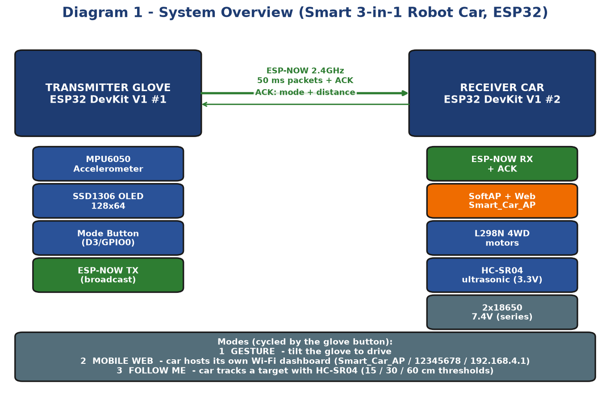
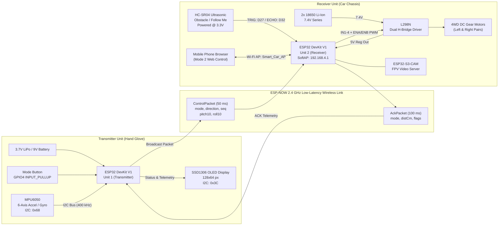
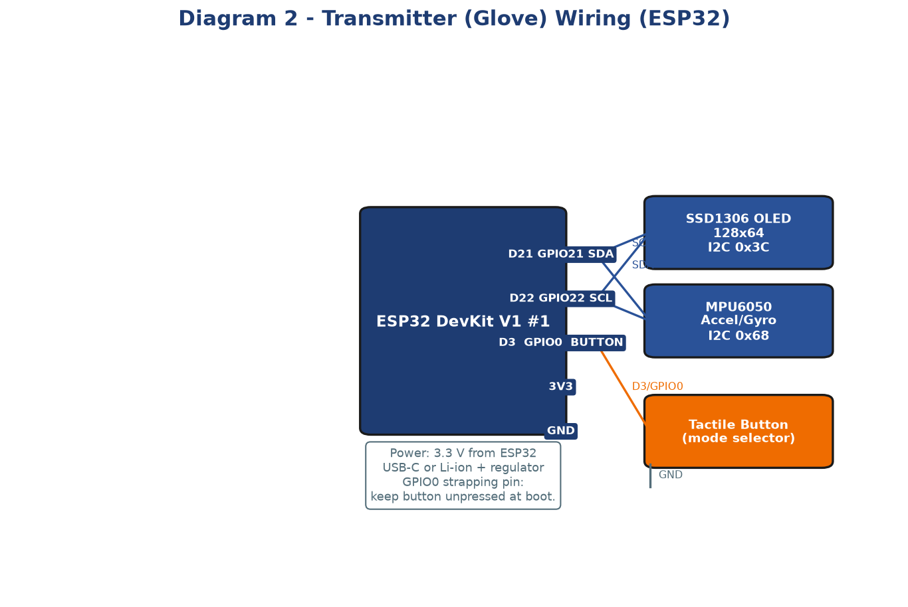
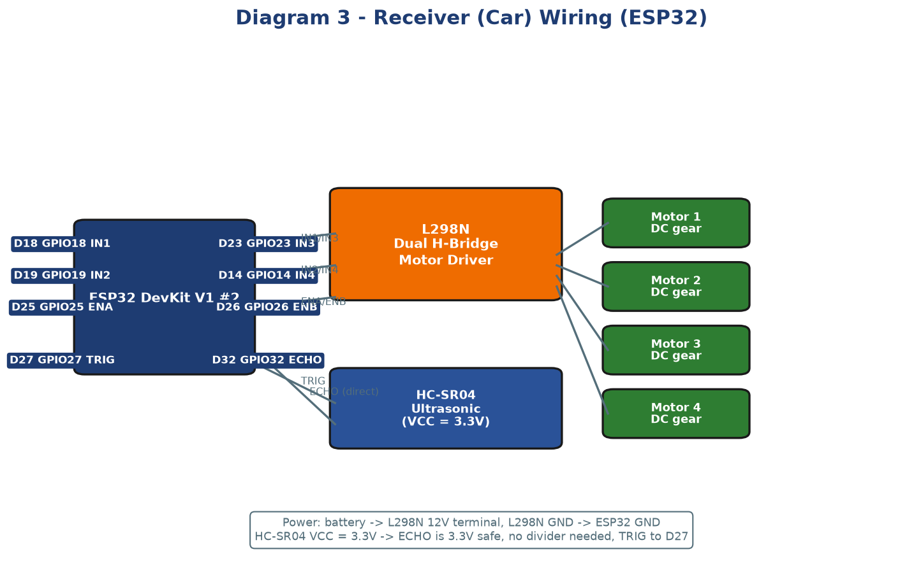
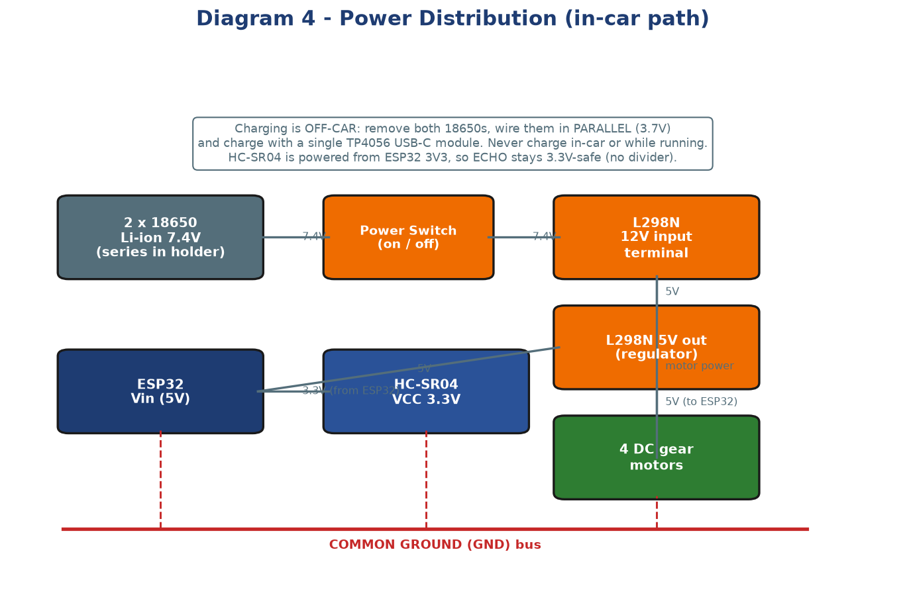
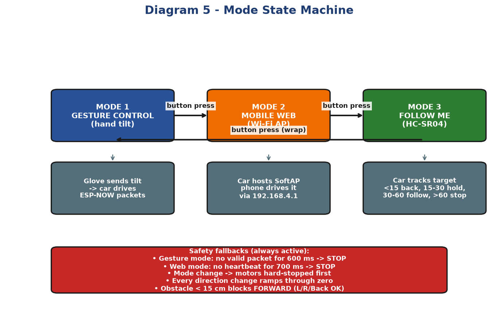
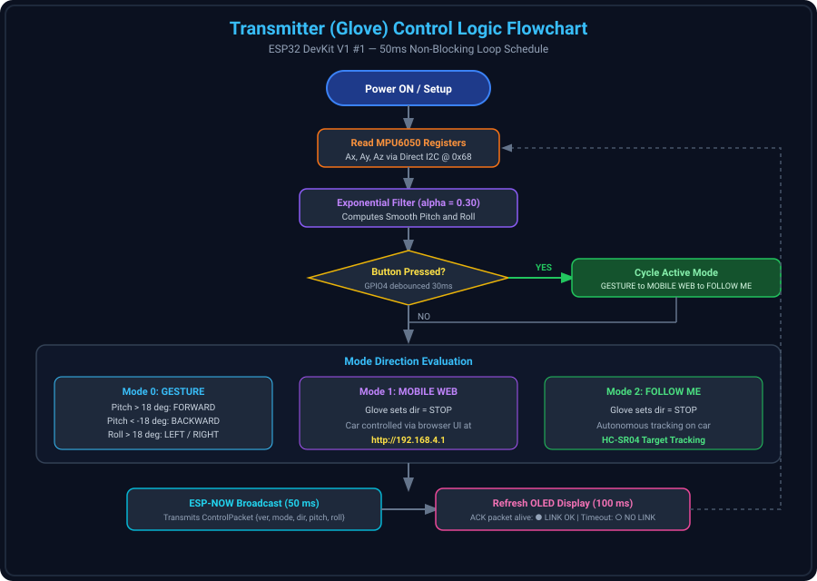
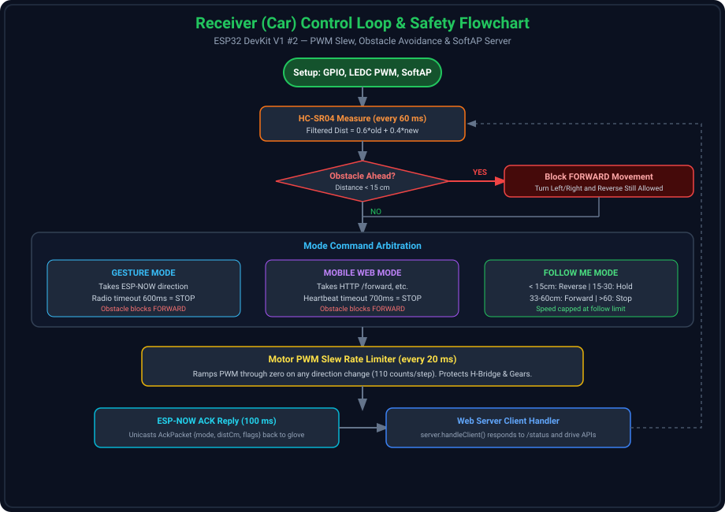
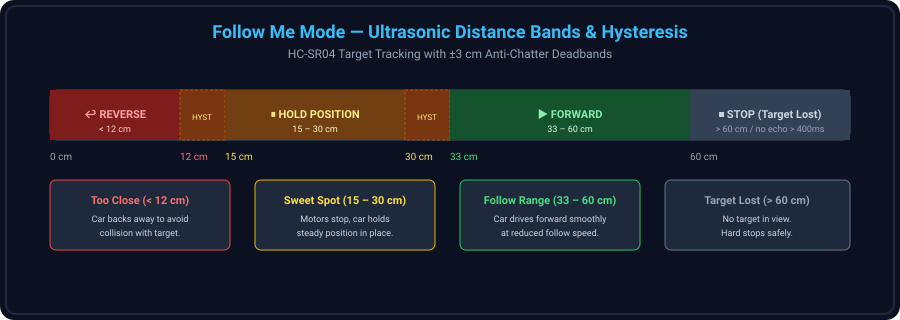

# Smart 3-in-1 Robot Car — Visual Overview & System Architecture

> **Made by Jagadish Sahoo** | ESP32 DevKit V1 | Firmware v2.0-ESP32
>
> Complete visual hardware schematics, block diagrams, component pinouts, and system flowcharts for the Smart 3-in-1 Multi-Mode ESP32 Robot Car with FPV.

---

## Table of Contents
1. [Block Diagram (System Overview)](#1-block-diagram)
2. [Circuit & Wiring Diagrams](#2-circuit--wiring-diagrams)
   - [2a. Transmitter (Glove) Circuit](#2a-transmitter-glove-wiring)
   - [2b. Receiver (Car) Circuit](#2b-receiver-car-wiring)
   - [2c. Power Distribution Architecture](#2c-power-distribution-architecture)
3. [Components Used (BOM)](#3-components-used)
4. [System Flowcharts](#4-system-flowcharts)
   - [4a. Mode State Machine](#4a-mode-state-machine)
   - [4b. Transmitter (Glove) Control Logic](#4b-transmitter-glove-control-logic-flowchart)
   - [4c. Receiver (Car) Control Loop & Safety](#4c-receiver-car-control-loop--safety-flowchart)
   - [4d. Follow Me Mode Distance Zones & Hysteresis](#4d-follow-me-mode-distance-zones--hysteresis)
5. [End-to-End System Workflow & Component Functional Breakdown](#5-end-to-end-system-workflow--component-functional-breakdown)
   - [5a. Subsystems & Component Functional Roles](#5a-subsystems--component-functional-roles)
   - [5b. Complete Step-by-Step Operating Workflow](#5b-complete-step-by-step-operating-workflow)
   - [5c. Hardware Protection & Failsafe Matrix](#5c-hardware-protection--failsafe-matrix)

---

## 1. Block Diagram

High-level architecture of the two-unit wireless robotic platform and communication channels.



<details>
<summary><b>View Mermaid Code (System Block Diagram)</b></summary>



</details>

---

## 2. Circuit & Wiring Diagrams

### 2a. Transmitter (Glove) Wiring

Schematic diagram for the hand glove unit connecting the ESP32, MPU6050, SSD1306 OLED, and mode selection push button.



#### Glove Pin Connection Table
| Signal / Function | ESP32 Pin | Connected Device & Pin | Description |
|---|---|---|---|
| **I2C SDA** | `D21` (GPIO 21) | MPU6050 `SDA` + OLED `SDA` | Shared fast I2C Data line (400 kHz) |
| **I2C SCL** | `D22` (GPIO 22) | MPU6050 `SCL` + OLED `SCL` | Shared fast I2C Clock line |
| **Mode Button** | `D4` (GPIO 4) | Tactile Push Button (Leg 1) | Internal pull-up (`INPUT_PULLUP`), safe boot pin |
| **Button GND** | `GND` | Tactile Push Button (Leg 2) | Pulls GPIO 4 LOW upon button press |
| **VCC (3.3V)** | `3V3` | MPU6050 `VCC` + OLED `VCC` | Regulated 3.3V sensor supply rail |
| **GND** | `GND` | MPU6050 `GND` + OLED `GND` | Common reference ground |

> [!NOTE]
> MPU6050 address is **`0x68`** and OLED address is **`0x3C`**. Both devices operate on 3.3V and coexist safely on the shared I2C bus.

---

### 2b. Receiver (Car) Wiring

Complete wiring schematic of the robot vehicle chassis: ESP32 receiver, L298N dual H-bridge motor driver, 4 DC motors, and the HC-SR04 ultrasonic distance sensor.



#### Car Pin Connection Table
| Signal / Function | ESP32 Pin | L298N / Sensor Terminal | Notes & Configuration |
|---|---|---|---|
| **Left Motors IN1** | `D18` (GPIO 18) | L298N `IN1` | Left side motor direction pin 1 |
| **Left Motors IN2** | `D19` (GPIO 19) | L298N `IN2` | Left side motor direction pin 2 |
| **Right Motors IN3** | `D23` (GPIO 23) | L298N `IN3` | Right side motor direction pin 1 |
| **Right Motors IN4** | `D14` (GPIO 14) | L298N `IN4` | Right side motor direction pin 2 |
| **Left Speed (PWM)** | `D25` (GPIO 25) | L298N `ENA` | **Remove jumper cap.** Driven via LEDC Channel 0 |
| **Right Speed (PWM)** | `D26` (GPIO 26) | L298N `ENB` | **Remove jumper cap.** Driven via LEDC Channel 1 |
| **Ultrasonic TRIG** | `D27` (GPIO 27) | HC-SR04 `TRIG` | 10 µs trigger pulse output |
| **Ultrasonic ECHO** | `D32` (GPIO 32) | HC-SR04 `ECHO` | Direct 3.3V echo input (safe, no resistor divider) |
| **Power VIN** | `VIN` | L298N `5V` Output | Regulated 5V from L298N powers the ESP32 |
| **Common GND** | `GND` | L298N `GND` + Battery Negative | Tied to a unified ground plane |

> [!WARNING]
> Always **remove the ENA and ENB black jumper caps** on the L298N module before attaching D25 and D26 wires. Leaving the jumpers in place connects ENA/ENB directly to 5V and will prevent PWM speed control.

> [!IMPORTANT]
> The HC-SR04 sensor in this design is powered from the ESP32 **3V3 pin**. This ensures its ECHO signal output is 3.3V compliant, protecting the ESP32 GPIO 32 pin without requiring an external resistor divider.

---

### 2c. Power Distribution Architecture

Power rails, regulator stages, and safe battery handling layout for the robot car.



#### Power Routing Summary
- **Primary Battery Source**: Two 18650 Li-Ion cells wired in series provide **7.4V nominal (8.4V fully charged)** through an SPST main power switch into the L298N `12V / +` screw terminal.
- **5V Logic Rail**: The onboard L298N 78M05 linear voltage regulator steps 7.4V down to 5.0V. The 5V terminal feeds the ESP32 `VIN` pin.
- **3.3V Sensor Rail**: The ESP32's onboard LDO steps 5V down to 3.3V to power the ESP32 processor core and the HC-SR04 ultrasonic distance sensor.
- **Ground (GND)**: All component grounds (battery negative, L298N GND, ESP32 GND, and sensor GND) must be tied to a single common bus.

> [!CAUTION]
> **Charging is OFF-CAR only.** The two 18650 cells in series (7.4V) cannot be charged by a standard 3.7V TP4056 module. Always remove both cells from the chassis holder, place them in parallel (3.7V) into the TP4056 USB-C charging dock, recharge, and reinstall. Never charge the battery while connected to the car.

---

## 3. Components Used

Full Bill of Materials (BOM) detailing all electronic modules, chassis parts, and hardware accessories.

### Core Electronics & Modules
| # | Component | Qty | Technical Specifications & Role |
|:---:|---|:---:|---|
| **1** | **ESP32 DevKit V1 (30-pin)** | 2 Units | Dual-core Tensilica Xtensa 240 MHz, 4MB Flash, Wi-Fi 802.11 b/g/n, ESP-NOW protocol.<br>• **Unit 1**: Transmitter Glove controller<br>• **Unit 2**: Receiver Robot Car controller |
| **2** | **ESP32-S3-CAM** | 1 Unit | High-performance dual-core ESP32-S3 with OV2640 / GC2145 camera module for real-time FPV Wi-Fi video streaming. |
| **3** | **MPU6050 IMU Module** | 1 Unit | 6-axis Accelerometer & Gyroscope (I2C address `0x68`). Mounted on the glove to read real-time hand pitch and roll tilt angles. |
| **4** | **SSD1306 0.96″ I2C OLED Display** | 1 Unit | 128×64 monochrome display (I2C address `0x3C`). Mounted on the glove to display active mode, live tilt angles, link quality, and distance feedback. |
| **5** | **L298N Dual H-Bridge Driver** | 1 Unit | High-power motor driver (up to 2A per channel). Controls forward/reverse directions and handles LEDC PWM speed control for 4 motors. |
| **6** | **HC-SR04 Ultrasonic Sensor** | 1 Unit | Non-contact sonar sensor (2 cm to 400 cm range). Mounted on car front bumper for obstacle detection and autonomous tracking. |
| **7** | **DC Geared BO Motors & Wheels** | 4 Units | 3–6V yellow dual-shaft gear motors with 65 mm high-traction rubber-tread wheels. Left side and right side motors are wired in parallel. |

### Assembly & Wiring Accessories
| # | Accessory Part | Qty | Purpose & Installation Notes |
|:---:|---|:---:|---|
| **8** | **Tactile Push Button** | 1 Unit | Glove mode selector switch connected between `D4` and `GND` (`INPUT_PULLUP`). |
| **9** | **18650 Li-Ion Batteries & Holder** | 2 Cells + Holder | 7.4V (2S series) pack mounted on chassis to power motors and car ESP32. |
| **10** | **Glove Power Source** | 1 Set | Compact 3.7V LiPo or 9V battery supplying the transmitter glove independently. |
| **11** | **SPST Rocker Switches** | 2 Units | In-line power switches for car chassis and transmitter glove. |
| **12** | **Jumper Ribbon Wires** | 30–40 Pcs | High-grade Male-to-Male, Male-to-Female, and Female-to-Female connections. |
| **13** | **Mini Breadboards / Zero PCB** | 2 Units | Distributes 3.3V, 5V, common GND rails and shared I2C buses. |
| **14** | **4WD Robot Car Chassis Kit** | 1 Kit | Acrylic/PVC dual-layer base plates, motor brackets, M3 standoffs, screws, and nuts. |
| **15** | **Fabric Glove & Velcro Straps** | 1 Set | Wearable glove with adjustable Velcro mounts for the ESP32, MPU6050, OLED, and button. |
| **16** | **TP4056 USB-C Charger Module** | 1 Unit | External dock for safe parallel (3.7V) recharging of 18650 cells. |

---

## 4. System Flowcharts

### 4a. Mode State Machine

The glove controller cycles sequentially between the 3 operating modes upon each button press. Every mode transition enforces an immediate motor hard-stop.



#### Mode Characteristics Table
| Mode Index | Mode Name | Control Source | Safety Features & Behavior |
|:---:|---|---|---|
| **Mode 0** | **GESTURE** | Hand tilt (MPU6050 pitch & roll) via ESP-NOW | Radio link timeout > 600 ms stops car. Obstacle < 15 cm blocks FORWARD motion. |
| **Mode 1** | **MOBILE WEB** | SoftAP Wi-Fi web dashboard (`http://192.168.4.1`) | Heartbeat timeout > 700 ms stops car. Obstacle < 15 cm blocks FORWARD motion. |
| **Mode 2** | **FOLLOW ME** | Autonomous front HC-SR04 sonar tracking | `< 12 cm`: Reverse • `15–30 cm`: Hold position • `33–60 cm`: Forward • `> 60 cm`: Stop. |

---

### 4b. Transmitter (Glove) Control Logic Flowchart

Non-blocking loop running on ESP32 Unit #1: reads MPU6050, filters angles, polls the mode button, transmits broadcast packets, and updates the OLED display.



---

### 4c. Receiver (Car) Control Loop & Safety Flowchart

Main control loop on ESP32 Unit #2: handles sonar distance measurement, automatic obstacle avoidance, speed ramp slew control, ACK replies, and the SoftAP web server.



---

### 4d. Follow Me Mode Distance Zones & Hysteresis

The autonomous tracking algorithm employs a multi-zone threshold band with ±3 cm hysteresis to eliminate chatter near the zone boundaries.



---

## 5. End-to-End System Workflow & Component Functional Breakdown

This section explains in technical and practical detail: **what every component does**, **how the subsystems interact**, and the **total step-by-step operating workflow** across all modes.

```
+-------------------------------------------------------------------------------------------------------------+
|                                           COMPLETE SYSTEM ECOSYSTEM                                         |
+-------------------------------------------------------------------------------------------------------------+
|  [ TRANSMITTER GLOVE ]                                              [ ROBOT VEHICLE PLATFORM ]               |
|  - MPU6050: Hand tilt capture (pitch/roll)                         - ESP32 RX: Command & safety arbiter     |
|  - Push Button: Mode cycle (0 -> 1 -> 2)                           - HC-SR04: 3.3V Sonar obstacle/follow    |
|  - ESP32 TX: Angle math, filtering & ESP-NOW TX                    - L298N: Dual H-Bridge motor driver      |
|  - SSD1306 OLED: Mode, tilt, link status & ACK dist                - 4x DC BO Motors: 4WD skid steering     |
|                                                                    - 2x 18650 (7.4V): High-current supply   |
|                                                                                                             |
|                    ESP-NOW Wireless Broadcast (2.4 GHz, 50 ms loop, < 5 ms latency)                         |
|                    ===============================================================>                         |
|                    <===============================================================                         |
|                    ESP-NOW Unicast ACK Reply (100 ms loop, live distance & status)                          |
|                                                                                                             |
|  [ OPERATOR PHONE BROWSER ]                                         [ ONBOARD FPV CAMERA ]                  |
|  - Connects to Wi-Fi SoftAP: Smart_Car_AP                           - ESP32-S3-CAM: Independent module      |
|  - Opens http://192.168.4.1 (Web dashboard)                        - OV2640 Lens: Real-time video capture  |
|  - Sends directional touch commands                                 - SoftAP: ESP32-S3-CAM-Hotspot          |
|  - 150 ms active heartbeat loop                                     - Serves MJPEG stream @ :81/stream      |
+-------------------------------------------------------------------------------------------------------------+
```

---

### 5a. Subsystems & Component Functional Roles

The system is partitioned into three decoupled hardware units working in harmony:

#### Unit 1: Transmitter Glove (Wearable Input & Telemetry Display)
1. **ESP32 DevKit V1 (Transmitter Microcontroller)**:
   - Serves as the central intelligence of the wearable glove.
   - Runs a 100% non-blocking loop scheduled using `millis()`.
   - Polls the MPU6050 sensor at 400 kHz, executes trigonometric tilt angle calculations, applies low-pass digital filtering, manages mode state transitions, broadcasts ESP-NOW packets every 50 ms, and refreshes the OLED every 100 ms.
2. **MPU6050 6-Axis Motion Tracking Sensor (I2C: `0x68`)**:
   - Contains a 3-axis MEMS accelerometer and 3-axis gyroscope.
   - Driven via **direct I2C register access** (no heavy third-party libraries), eliminating software version incompatibilities.
   - Measures raw gravitational acceleration vectors ($A_x, A_y, A_z$) to detect wrist and palm orientation.
   - Converts raw vectors into physical angular pitch ($P$) and roll ($R$) degrees via:
     $$\text{Pitch} = \text{atan2}(A_y, \sqrt{A_x^2 + A_z^2}) \times \frac{180}{\pi}$$
     $$\text{Roll} = \text{atan2}(-A_x, \sqrt{A_y^2 + A_z^2}) \times \frac{180}{\pi}$$
   - Smoothed continuously through a first-order exponential filter ($\alpha = 0.30$) to reject involuntary hand tremors.
3. **SSD1306 0.96″ I2C OLED Display (I2C: `0x3C`)**:
   - Displays real-time visual feedback to the driver on the back of the hand.
   - Top status bar: Live RF link health (filled dot `● LINK OK` when ACKs arrive, open circle `○ NO LINK` on timeout) and mode indicator (`M1/3`, `M2/3`, `M3/3`).
   - Center graphics: Animated mode icons (Hand gesture icon, Wi-Fi radio wave icon, or Robot head icon).
   - Bottom telemetry: Exact filtered Pitch and Roll degrees, active direction sent (`FWD`, `BACK`, `LEFT`, `RIGHT`, `STOP`), or live obstacle distance returned from the car in centimeters.
4. **Tactile Push Button**:
   - Single-button multi-mode switch connected between `D4` (GPIO 4) and `GND`.
   - Utilizes ESP32 internal `INPUT_PULLUP`. GPIO 4 is a boot-safe pin with no strapping restrictions.
   - Debounced for 30 ms in software; toggles between the 3 operating modes upon every click.
5. **Glove Battery Pack**:
   - Dedicated 3.7V LiPo cell (or 9V battery) feeding the ESP32 `VIN` pin through a power toggle switch, completely isolating glove power from car motor noise.

---

#### Unit 2: Robot Vehicle Platform (Receiver, Motor Driver & Safety Arbiter)
1. **ESP32 DevKit V1 (Receiver Microcontroller)**:
   - Listens for incoming ESP-NOW packets on Wi-Fi Channel 1 with sub-5 millisecond latency.
   - Hosts a concurrent Wi-Fi SoftAP (`Smart_Car_AP`) and embedded Web Server (`WebServer.h`) serving the touch dashboard stored in flash memory (`PROGMEM`).
   - Executes ultrasonic obstacle verification every 60 ms and feeds motor commands into a 20 ms rate-limiting PWM slew filter.
   - Unicasts `AckPacket` telemetry back to the glove MAC address every 100 ms.
2. **L298N Dual H-Bridge Motor Driver**:
   - Takes high-current 7.4V battery power and drives 4 geared DC motors using skid-steering kinematics.
   - **Direction Logic (`IN1`, `IN2`, `IN3`, `IN4`)**: Controls H-bridge transistor polarity to spin left and right motor banks forward, backward, or brake.
   - **Speed Control (`ENA`, `ENB`)**: Jumpers removed; connected directly to ESP32 pins `D25` and `D26`. Driven by ESP32 **LEDC hardware PWM** (10-bit resolution, 0 to 1023 counts at 1 kHz frequency).
   - **Internal 5V Regulator (78M05)**: Steps down battery 7.4V to clean 5V to power the ESP32 `VIN` pin and motor logic circuitry.
3. **HC-SR04 Ultrasonic Distance Sensor**:
   - Emits 40 kHz ultrasonic sound bursts via pin `D27` (TRIG, 10 µs pulse) and measures reflection time on pin `D32` (ECHO).
   - **Powered safely from ESP32 3V3 rail**: Operates at 3.3V logic level, meaning the ECHO pin outputs safe 3.3V pulses directly to GPIO 32 without needing an external resistor voltage divider.
   - Distances are smoothed via an Exponentially Weighted Moving Average (EWMA: $0.6 \times \text{old} + 0.4 \times \text{new}$).
   - Serves dual roles: **Autonomous target tracker** in Follow-Me mode, and **hardware safety shield** in Gesture & Web modes.
4. **4WD Geared BO Motors & Rubber Wheels**:
   - Four 3–6V yellow dual-shaft DC motors with 1:48 internal reduction gearboxes.
   - Left-front and left-rear motors wired in parallel into L298N Channel A (`OUT1`/`OUT2`).
   - Right-front and right-rear motors wired in parallel into L298N Channel B (`OUT3`/`OUT4`).
   - Turning is achieved by skid-steering (spinning left and right sides in opposite directions or differential speeds).
5. **Dual 18650 Li-Ion Battery Pack (7.4V 2S)**:
   - Delivers high instantaneous discharge current (up to 3–4A during motor stall/acceleration) without resetting the ESP32.

---

#### Unit 3: ESP32-S3-CAM FPV Wireless Video Streamer
1. **ESP32-S3 Dual-Core SoC + PSRAM**:
   - Dedicated exclusively to video acquisition and high-speed streaming so camera processing never interferes with motor timing or safety stops.
   - Utilizes onboard 8MB Octal PSRAM (`OPI PSRAM`) as a double-buffered frame repository.
2. **OV2640 2.0 Megapixel Camera Sensor**:
   - Directly streams Motion-JPEG (MJPEG) compressed frames at QVGA / VGA resolutions at 25–30 frames per second.
3. **Independent SoftAP Video Server**:
   - Generates its own Wi-Fi network (`ESP32-S3-CAM-Hotspot`) on `http://192.168.4.1:81/stream`.
   - The driver views live video directly on a phone or laptop mounted above the glove or on a desk.

---

### 5b. Complete Step-by-Step Operating Workflow

#### Step 1: System Power-Up & Handshake
1. The operator turns ON the glove switch and car chassis switch.
2. **Glove Init**: OLED shows the 2.6-second branding splash screen (*"SMART CAR v1.0 — Jagadish Sahoo"*). The ESP32 initializes I2C bus at 400 kHz, verifies MPU6050 identity register (`WHO_AM_I = 0x68`), configures ESP-NOW on Channel 1, and enters default **Mode 0 (GESTURE)**.
3. **Car Init**: Motors are set to `HARD_STOP`. LEDC PWM channels 0 and 1 are configured. The SoftAP Wi-Fi network `Smart_Car_AP` starts. The Web Server begins listening on Port 80. ESP-NOW receive callback is registered.
4. **Wireless Handshake**: When the first 50 ms broadcast packet from the glove reaches the car, the car grabs the glove's MAC address (`ackDest`) and registers it as an ESP-NOW peer. Within 100 ms, the car sends back an `AckPacket`. The glove OLED link dot changes from open `○ NO LINK` to solid `● LINK OK`.

---

#### Step 2: Mode 0 — Hand Gesture Driving Workflow
1. **Tilt Detection**: The driver tilts their hand forward, backward, left, or right.
2. **Filtering & Deadband**:
   - Tilt angles are calculated and filtered ($\alpha = 0.30$).
   - **Activation Threshold**: An axis must exceed **18.0°** tilt to trigger motion.
   - **Hysteresis Release**: The command remains locked until tilt drops back below **10.0°**. This prevents the motors from stuttering or jittering near the boundary.
   - **Dominance Check**: Whichever axis has the larger absolute angle ($|\text{Pitch}|$ vs $|\text{Roll}|$) takes priority, ensuring diagonal tilts don't send conflicting directions.
3. **Packet Transmission**: The glove packs `ControlPacket` (`mode = 0`, `dir`, `pitch10`, `roll10`, `seq++`) and broadcasts it over ESP-NOW every 50 ms.
4. **Car Safety Check**:
   - The car receives the direction.
   - If the direction is **FORWARD**, the car reads its current ultrasonic distance.
   - **Obstacle Lockout**: If an object is detected closer than **15 cm**, the FORWARD command is automatically overridden to `STOP`! The car will refuse to drive forward into a wall. Backward, Left, and Right commands remain active so the operator can safely steer away.
5. **Smooth Motor Slew Ramp**:
   - The car does not instantly slam full voltage onto the motors (which would strip gearbox teeth and spike battery current).
   - A 20 ms slew rate controller steps PWM up or down by **110 counts per tick**.
   - If changing direction (e.g. Forward to Reverse), the PWM must **ramp all the way down to 0** before the H-bridge polarity pins are flipped.
6. **Telemetry Feedback**: The car returns its live distance in the ACK packet; the glove OLED displays the measured distance and link confirmation.

---

#### Step 3: Mode 1 — Mobile Web Control Workflow
1. **Mode Switch**: The operator presses the tactile button on the glove. Current mode changes to `MODE_MOBILE_WEB`. The glove OLED displays: `AP: Smart_Car_AP` and `http://192.168.4.1`.
2. **Glove State**: While in Web mode, the glove transmits `DIR_STOP` over ESP-NOW so hand motions do not move the car.
3. **Phone Connection**: The operator connects their smartphone to the car's Wi-Fi network (`Smart_Car_AP`, password `12345678`) and opens `http://192.168.4.1` in Chrome or Safari.
4. **Web UI Operation**:
   - The phone loads the dark-themed touch keypad served directly from flash memory.
   - The browser polls `/status` every 1000 ms to display live car telemetry (active mode, ultrasonic distance, obstacle warnings).
   - Pressing and holding a directional pad button (`▲ Forward`, `◀ Left`, `▶ Right`, `▼ Backward`) fires an HTTP `GET /forward` request.
   - While held, JavaScript sends an **active heartbeat every 150 ms**.
   - Releasing the button sends `/stop`.
5. **Safety Failsafe**: If Wi-Fi signal drops or the phone browser is minimized for more than **700 ms**, the car's watchdog timer trips and forces `motorsHardStop()`.

---

#### Step 4: Mode 2 — Follow-Me Autonomous Tracking Workflow
1. **Mode Switch**: Pressing the glove button again cycles the car into `MODE_FOLLOW_ME`.
2. **Autonomous Sonar Loop**: The glove hands over complete steering authority to the car's onboard ultrasonic algorithm, which samples every 60 ms:
   - **Zone 1: Danger Zone ($< 12\text{ cm}$)**: Target is too close! The car drives in reverse (`SPEED_FOLLOW = 520`) to restore safe separation.
   - **Zone 2: Hold Position ($15\text{ cm} \text{ to } 30\text{ cm}$)**: The optimal sweet spot. Both motors are stopped; the car rests patiently in front of the human hand or obstacle.
   - **Zone 3: Tracking Zone ($33\text{ cm} \text{ to } 60\text{ cm}$)**: Target is walking away! The car drives forward smoothly to maintain pace.
   - **Zone 4: Target Lost ($> 60\text{ cm}$ or no echo $> 400\text{ ms}$)**: Target went out of range or turned a sharp corner. The car immediately stops in place rather than blindly driving forward.
   - **Anti-Chatter Hysteresis**: Deadbands at 12–15 cm and 30–33 cm prevent rapid back-and-forth oscillation at zone boundaries.
3. Telemetry continues streaming to the glove OLED so the driver can monitor target tracking distance in real-time.

---

#### Step 5: FPV Real-Time Camera Stream Workflow
1. The ESP32-S3-CAM module powers up with the vehicle.
2. It initializes the OV2640 sensor in JPEG mode with PSRAM double-buffering.
3. It launches Wi-Fi SoftAP `ESP32-S3-CAM-Hotspot`.
4. The driver opens `http://192.168.4.1:81/stream` on their secondary device or in a split browser window.
5. Live 30 FPS video streams from the robot's front perspective, enabling remote beyond-line-of-sight (BLOS) navigation.

---

### 5c. Hardware Protection & Failsafe Matrix

The system includes multi-tier hardware and software failsafes to protect microcontrollers, motors, and battery cells from damage:

| Failsafe Mechanism | Trigger Condition | System Response | Hardware Protection Purpose |
|---|---|---|---|
| **Radio Loss Watchdog** | No ESP-NOW packet received for $> 600\text{ ms}$ | Car forces `DIR_STOP` immediately | Prevents runaway vehicle if glove battery dies or moves out of range. |
| **Web Heartbeat Watchdog** | No HTTP command received for $> 700\text{ ms}$ in Web Mode | Car forces `DIR_STOP` immediately | Prevents runaway if smartphone loses Wi-Fi connection. |
| **Ultrasonic Safety Stop** | Obstacle detected $< 15\text{ cm}$ ahead | Blocks `FORWARD` command in Gesture and Web modes | Prevents front bumper crashes into walls, furniture, or humans. |
| **Slew Rate PWM Limiter** | Every speed or direction update ($20\text{ ms}$ tick) | Steps PWM at $110\text{ counts}$ per tick | Eliminates mechanical shock and gear stripping on DC gearboxes. |
| **Zero-Crossing Reversal** | Direction change (e.g. Forward $\to$ Backward) | PWM ramps to $0$ before H-bridge pins flip | Eliminates back-EMF inductive voltage spikes that destroy L298N FETs. |
| **3.3V Logic Compliance** | HC-SR04 sensor VCC tied to ESP32 `3V3` | ECHO pin outputs safe $3.3\text{V}$ high level | Protects ESP32 GPIO 32 from over-voltage burnout without resistor dividers. |
| **I2C Bus Coexistence** | Shared bus on pins `D21` (SDA) and `D22` (SCL) | MPU6050 at `0x68`, OLED at `0x3C` | Allows two I2C devices to share 2 microcontroller pins without address collisions. |
| **Off-Car Charging Protocol** | 2S series pack ($7.4\text{V}$) requires charging | Cells removed and wired in parallel ($3.7\text{V}$) into TP4056 | Prevents battery fire or overcharging inherent in trying to charge 7.4V with 3.7V modules. |

---

## Project Repository Structure

```
PRPWA/
├── README.md                                    # Main project documentation & quick start
├── OVERVIEW.md                                  # Complete visual guide (diagrams, BOM, flowcharts)
├── platformio.ini                               # PlatformIO dual-target build configuration
│
├── Receiver_Car/                                # Unit #2 — Car receiver sketch
│   ├── Receiver_Car.ino
│   └── WebPage.h                                # Embedded HTML/JS control dashboard
│
├── Transmitter_Glove/                           # Unit #1 — Glove transmitter sketch
│   └── Transmitter_Glove.ino
│
├── ESP32S3_CAM/                                 # Unit #3 — FPV camera sketch (ESP32-S3)
│   ├── ESP32S3_CAM_AP.ino                      # Camera Wi-Fi SoftAP & stream server
│   ├── app_httpd.cpp
│   ├── board_config.h
│   ├── camera_pins.h
│   └── camera_index.h
│
├── firmware/                                    # Pre-built ready-to-flash binaries (address 0x0)
│   ├── Receiver_Car.bin
│   ├── Transmitter_Glove.bin
│   └── ESP32S3_CAM_AP_merged.bin
│
└── docs/
    ├── report/
    │   └── ESP32_Gesture_RC_Car_Project_Report_Updated.docx
    └── diagrams/                                # All diagram graphics referenced in OVERVIEW.md
        ├── 1_system_overview_block_diagram.png
        ├── 2_transmitter_glove_circuit.png
        ├── 3_receiver_car_circuit.png
        ├── 4_power_distribution.png
        ├── 5_mode_state_machine.png
        ├── 6_gesture_control_flowchart.svg
        ├── 7_receiver_car_flowchart.svg
        └── 8_follow_me_zones.svg
```
