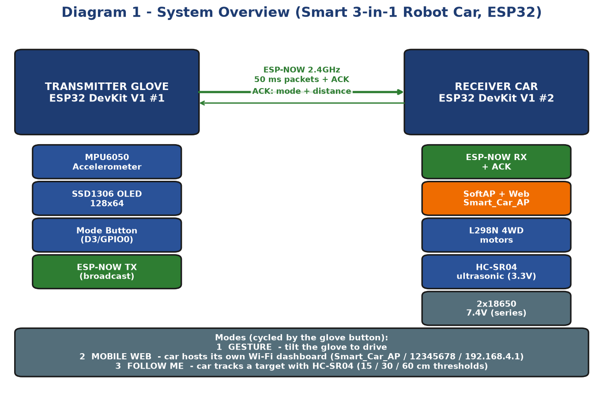
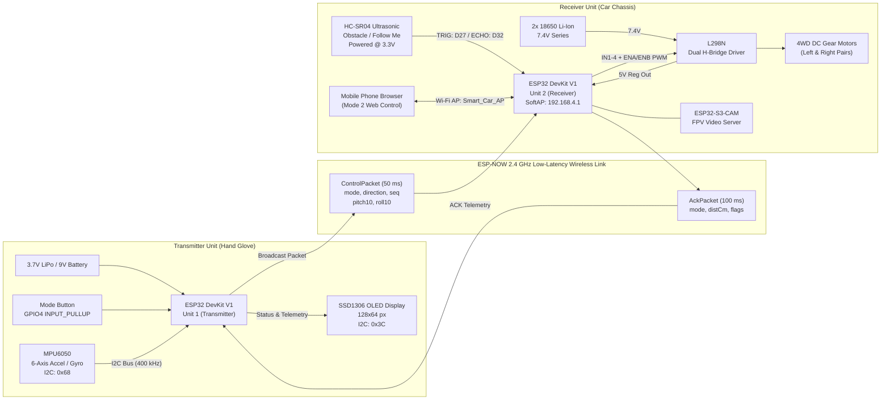
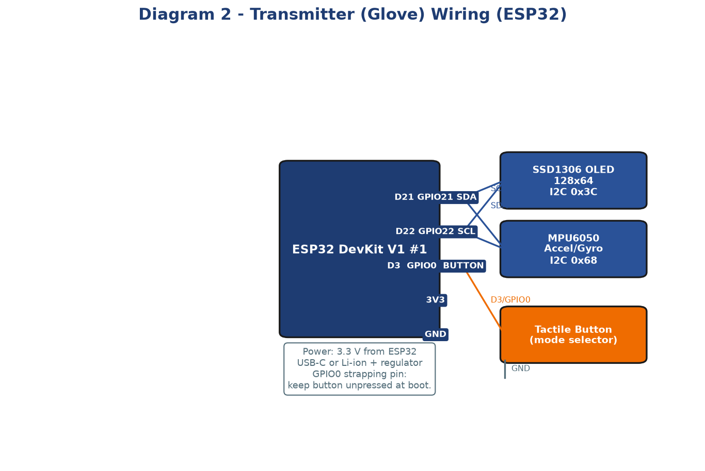
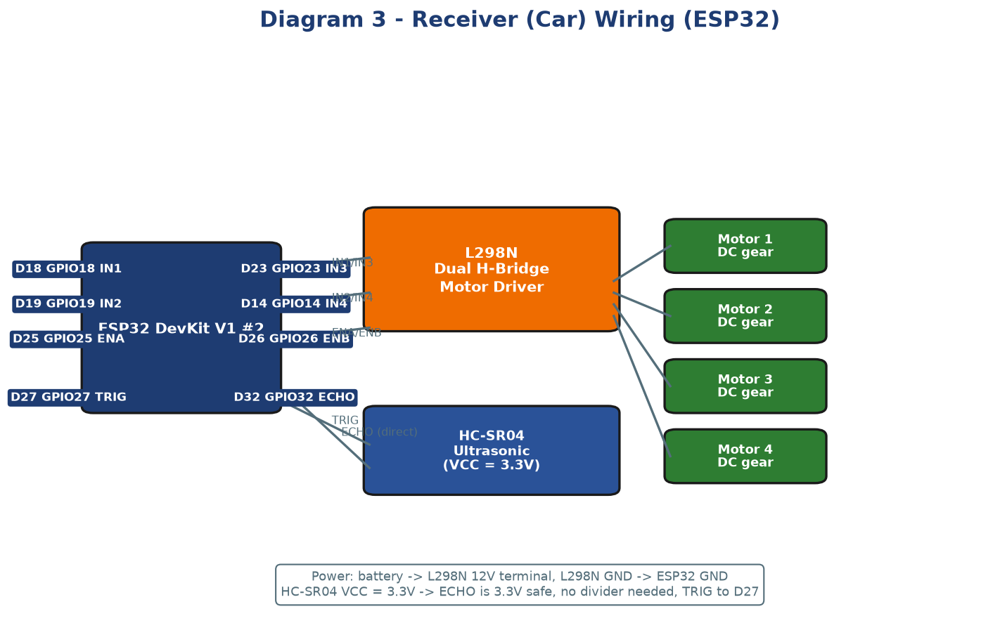
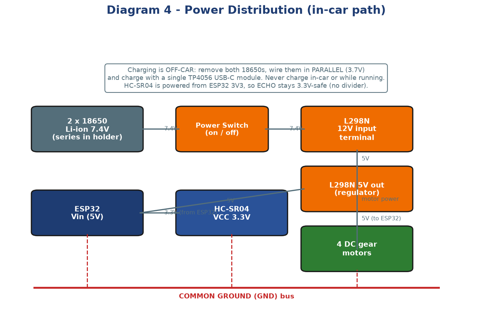
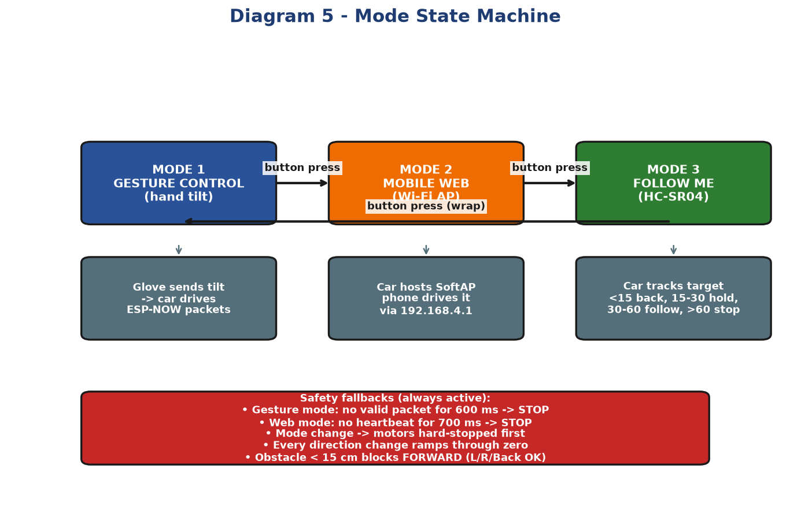
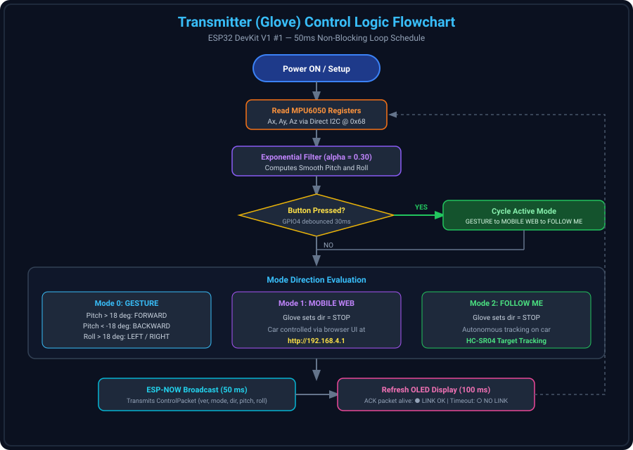
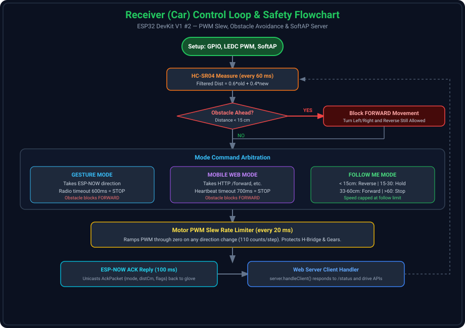
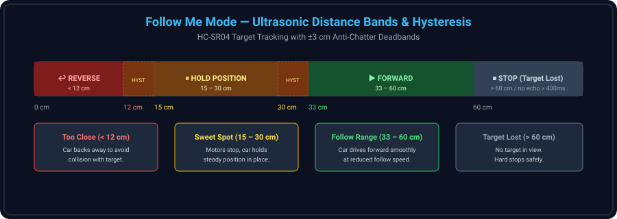

# Smart 3-in-1 Robot Car & FPV System — Master Documentation

> **Made by Jagadish Sahoo** | ESP32 DevKit V1 + ESP32-S3-CAM | Firmware v2.0-ESP32
>
> Complete Unified Guide: System Architecture, Block & Circuit Diagrams, Hardware BOM, Build & Flashing Guide, Operational Workflows, Tuning, and Safety Failsafes.

---

## Table of Contents
1. [Repository Layout & File Structure](#1-repository-layout--file-structure)
2. [System Overview & Block Diagram](#2-system-overview--block-diagram)
3. [Circuit & Wiring Diagrams](#3-circuit--wiring-diagrams)
   - [3a. Transmitter (Glove) Wiring & Pinout](#3a-transmitter-glove-wiring--pinout)
   - [3b. Receiver (Car) Wiring & Pinout](#3b-receiver-car-wiring--pinout)
   - [3c. Power Distribution Architecture](#3c-power-distribution-architecture)
4. [Components Used (Complete BOM)](#4-components-used-complete-bom)
5. [System Flowcharts](#5-system-flowcharts)
   - [5a. Mode State Machine](#5a-mode-state-machine)
   - [5b. Transmitter (Glove) Control Logic Flowchart](#5b-transmitter-glove-control-logic-flowchart)
   - [5c. Receiver (Car) Control Loop & Safety Flowchart](#5c-receiver-car-control-loop--safety-flowchart)
   - [5d. Follow Me Mode Distance Zones & Hysteresis](#5d-follow-me-mode-distance-zones--hysteresis)
6. [End-to-End System Workflow & Component Functional Breakdown](#6-end-to-end-system-workflow--component-functional-breakdown)
   - [6a. Subsystems & Component Functional Roles](#6a-subsystems--component-functional-roles)
   - [6b. Step-by-Step Operating Workflow (All Modes & FPV)](#6b-step-by-step-operating-workflow-all-modes--fpv)
   - [6c. Hardware Protection & Failsafe Matrix](#6c-hardware-protection--failsafe-matrix)
7. [Flashing Pre-Built Firmware Binaries](#7-flashing-pre-built-firmware-binaries)
   - [7a. Car & Glove Flashing](#7a-car--glove-flashing)
   - [7b. ESP32-S3-CAM Flashing](#7b-esp32-s3-cam-flashing)
8. [Building & Compiling from Source](#8-building--compiling-from-source)
   - [8a. Arduino IDE Setup](#8a-arduino-ide-setup)
   - [8b. PlatformIO Configuration](#8b-platformio-configuration)
9. [Operational Guide & Usage Instructions](#9-operational-guide--usage-instructions)
   - [9a. Mode Selection](#9a-mode-selection)
   - [9b. Mode 0 — Hand Gesture Driving](#9b-mode-0--hand-gesture-driving)
   - [9c. Mode 1 — Mobile Web Dashboard](#9c-mode-1--mobile-web-dashboard)
   - [9d. Mode 2 — Autonomous Follow-Me](#9d-mode-2--autonomous-follow-me)
   - [9e. Real-Time FPV Camera Stream](#9e-real-time-fpv-camera-stream)
10. [Critical Behaviors & Safety Guidelines](#10-critical-behaviors--safety-guidelines)
11. [Software Tuning & Calibration Reference](#11-software-tuning--calibration-reference)
12. [Assembly Notes & Troubleshooting](#12-assembly-notes--troubleshooting)

---

## 1. Repository Layout & File Structure

```
PRPWA/
├── README.md                                    # Master project documentation & complete guide
├── platformio.ini                               # PlatformIO dual-target build configuration
├── .vscode/                                     # VS Code workspace settings & IntelliSense
│   ├── c_cpp_properties.json                    # ESP32 C/C++ compiler and include paths
│   └── extensions.json                          # Recommended VS Code extensions
│
├── Receiver_Car/                                # Unit #2 — Car receiver sketch
│   ├── Receiver_Car.ino                         # Main vehicle firmware (ESP-NOW, PWM, Web Server)
│   └── WebPage.h                                # Embedded HTML/JS control dashboard (PROGMEM)
│
├── Transmitter_Glove/                           # Unit #1 — Glove transmitter sketch
│   └── Transmitter_Glove.ino                    # Wearable remote firmware (MPU6050, OLED, ESP-NOW)
│
├── ESP32S3_CAM/                                 # Unit #3 — FPV camera sketch (ESP32-S3)
│   ├── ESP32S3_CAM_AP.ino                      # Camera Wi-Fi SoftAP & stream server
│   ├── app_httpd.cpp                            # HTTP camera streaming engine
│   ├── board_config.h                           # Camera model selector (ESP32S3_EYE default)
│   ├── camera_pins.h                            # Pin definitions for supported camera boards
│   ├── camera_index.h                           # Embedded camera web UI
│   ├── partitions.csv                           # Custom partition table (3MB app space)
│   ├── ci.yml                                   # Continuous integration build matrix
│   └── .vscode/c_cpp_properties.json            # ESP32-S3 IntelliSense configuration
│
├── firmware/                                    # Ready-to-flash compiled binaries
│   ├── Receiver_Car.bin                         # Car receiver image (flash @ 0x0)
│   ├── Transmitter_Glove.bin                    # Glove remote image (flash @ 0x0)
│   ├── ESP32S3_CAM_AP_merged.bin                # Merged CAM image (flash @ 0x0, single-step)
│   ├── ESP32S3_CAM_AP.bin                       # CAM application only (flash @ 0x10000)
│   ├── ESP32S3_CAM_AP.bootloader.bin            # CAM bootloader (flash @ 0x0)
│   ├── ESP32S3_CAM_AP.partitions.bin            # CAM partition table (flash @ 0x8000)
│   └── boot_app0.bin                            # OTA boot selector data (flash @ 0xe000)
│
└── docs/
    ├── report/
    │   └── ESP32_Gesture_RC_Car_Project_Report_Updated.docx   # Comprehensive written project report
    └── diagrams/                                # High-resolution schematics and visual flowcharts
        ├── 1_system_overview_block_diagram.png
        ├── 2_transmitter_glove_circuit.png
        ├── 3_receiver_car_circuit.png
        ├── 4_power_distribution.png
        ├── 5_mode_state_machine.png
        ├── 6_gesture_control_flowchart.svg
        ├── 7_receiver_car_flowchart.svg
        ├── 8_follow_me_zones.svg
        ├── Smart_Car_Diagrams.docx               # Original diagram documentation
        └── Car Receiver & FPV System Connection Diagram.pdf  # FPV camera wiring sheet
```

---

## 2. System Overview & Block Diagram

High-level architecture showing the two primary ESP32 DevKit V1 units, the independent ESP32-S3-CAM module, the low-latency 2.4 GHz ESP-NOW wireless link, power distribution, and the mobile phone control interface.



<details>
<summary><b>View Mermaid Code (System Block Diagram)</b></summary>



</details>

---

## 3. Circuit & Wiring Diagrams

### 3a. Transmitter (Glove) Wiring & Pinout

Schematic diagram for the hand glove unit connecting the ESP32, MPU6050, SSD1306 OLED, and mode selection push button.



#### Glove Pin Connection Table
| Signal / Function | ESP32 Pin | Connected Device & Pin | Description |
|---|---|---|---|
| **I2C SDA** | `D21` (GPIO 21) | MPU6050 `SDA` + OLED `SDA` | Shared fast I2C Data line (400 kHz) |
| **I2C SCL** | `D22` (GPIO 22) | MPU6050 `SCL` + OLED `SCL` | Shared fast I2C Clock line |
| **Mode Button** | `D4` (GPIO 4) | Tactile Push Button (Leg 1) | Internal pull-up (`INPUT_PULLUP`), safe boot pin |
| **Button GND** | `GND` | Tactile Push Button (Leg 2) | Pulls GPIO 4 LOW upon button press |
| **VCC (3.3V)** | `3V3` | MPU6050 `VCC` + OLED `VCC` | Regulated 3.3V sensor supply rail |
| **GND** | `GND` | MPU6050 `GND` + OLED `GND` | Common reference ground |

> [!NOTE]
> MPU6050 address is **`0x68`** and OLED address is **`0x3C`**. Both devices operate on 3.3V and coexist safely on the shared I2C bus.

---

### 3b. Receiver (Car) Wiring & Pinout

Complete wiring schematic of the robot vehicle chassis: ESP32 receiver, L298N dual H-bridge motor driver, 4 DC motors, and the HC-SR04 ultrasonic distance sensor.



#### Car Pin Connection Table
| Signal / Function | ESP32 Pin | L298N / Sensor Terminal | Notes & Configuration |
|---|---|---|---|
| **Left Motors IN1** | `D18` (GPIO 18) | L298N `IN1` | Left side motor direction pin 1 |
| **Left Motors IN2** | `D19` (GPIO 19) | L298N `IN2` | Left side motor direction pin 2 |
| **Right Motors IN3** | `D23` (GPIO 23) | L298N `IN3` | Right side motor direction pin 1 |
| **Right Motors IN4** | `D14` (GPIO 14) | L298N `IN4` | Right side motor direction pin 2 |
| **Left Speed (PWM)** | `D25` (GPIO 25) | L298N `ENA` | **Remove jumper cap.** Driven via LEDC Channel 0 |
| **Right Speed (PWM)** | `D26` (GPIO 26) | L298N `ENB` | **Remove jumper cap.** Driven via LEDC Channel 1 |
| **Ultrasonic TRIG** | `D27` (GPIO 27) | HC-SR04 `TRIG` | 10 µs trigger pulse output |
| **Ultrasonic ECHO** | `D32` (GPIO 32) | HC-SR04 `ECHO` | Direct 3.3V echo input (safe, no resistor divider) |
| **Power VIN** | `VIN` | L298N `5V` Output | Regulated 5V from L298N powers the ESP32 |
| **Common GND** | `GND` | L298N `GND` + Battery Negative | Tied to a unified ground plane |

> [!WARNING]
> Always **remove the ENA and ENB black jumper caps** on the L298N module before attaching D25 and D26 wires. Leaving the jumpers in place connects ENA/ENB directly to 5V and prevents PWM speed control.

> [!IMPORTANT]
> The HC-SR04 sensor in this design is powered from the ESP32 **3V3 pin**. This ensures its ECHO signal output is 3.3V compliant, protecting the ESP32 GPIO 32 pin without requiring an external resistor divider.

---

### 3c. Power Distribution Architecture

Power rails, regulator stages, and safe battery handling layout for the robot car.



#### Power Routing Summary
- **Primary Battery Source**: Two 18650 Li-Ion cells wired in series provide **7.4V nominal (8.4V fully charged)** through an SPST main power switch into the L298N `12V / +` screw terminal.
- **5V Logic Rail**: The onboard L298N 78M05 linear voltage regulator steps 7.4V down to 5.0V. The 5V terminal feeds the ESP32 `VIN` pin.
- **3.3V Sensor Rail**: The ESP32's onboard LDO steps 5V down to 3.3V to power the ESP32 processor core and the HC-SR04 ultrasonic distance sensor.
- **Ground (GND)**: All component grounds (battery negative, L298N GND, ESP32 GND, and sensor GND) must be tied to a single common bus. Never connect USB and battery power simultaneously.

> [!CAUTION]
> **Charging is OFF-CAR only.** The two 18650 cells in series (7.4V) cannot be charged by a standard 3.7V TP4056 module. Always remove both cells from the chassis holder, wire them in parallel (3.7V) into the TP4056 USB-C charging dock, recharge, and reinstall. Never charge the battery while connected to the car or while running.

---

## 4. Components Used (Complete BOM)

Full Bill of Materials (BOM) detailing all electronic modules, chassis parts, and hardware accessories.

### Core Electronics & Modules
| # | Component | Qty | Technical Specifications & Role |
|:---:|---|:---:|---|
| **1** | **ESP32 DevKit V1 (30-pin)** | 2 Units | Dual-core Tensilica Xtensa 240 MHz, 4MB Flash, Wi-Fi 802.11 b/g/n, ESP-NOW protocol.<br>• **Unit 1**: Transmitter Glove controller<br>• **Unit 2**: Receiver Robot Car controller |
| **2** | **ESP32-S3-CAM** | 1 Unit | High-performance dual-core ESP32-S3 with OV2640 / GC2145 camera module for real-time FPV Wi-Fi video streaming. |
| **3** | **MPU6050 IMU Module** | 1 Unit | 6-axis Accelerometer & Gyroscope (I2C address `0x68`). Mounted on the glove to read real-time hand pitch and roll tilt angles. |
| **4** | **SSD1306 0.96″ I2C OLED Display** | 1 Unit | 128×64 monochrome display (I2C address `0x3C`). Mounted on the glove to display active mode, live tilt angles, link quality, and distance feedback. |
| **5** | **L298N Dual H-Bridge Driver** | 1 Unit | High-power motor driver (up to 2A per channel). Controls forward/reverse directions and handles LEDC PWM speed control for 4 motors. |
| **6** | **HC-SR04 Ultrasonic Sensor** | 1 Unit | Non-contact sonar sensor (2 cm to 400 cm range). Mounted on car front bumper for obstacle detection and autonomous tracking. |
| **7** | **DC Geared BO Motors & Wheels** | 4 Units | 3–6V yellow dual-shaft gear motors with 65 mm high-traction rubber-tread wheels. Left side and right side motors are wired in parallel. |

### Assembly & Wiring Accessories
| # | Accessory Part | Qty | Purpose & Installation Notes |
|:---:|---|:---:|---|
| **8** | **Tactile Push Button** | 1 Unit | Glove mode selector switch connected between `D4` and `GND` (`INPUT_PULLUP`). |
| **9** | **18650 Li-Ion Batteries & Holder** | 2 Cells + Holder | 7.4V (2S series) pack mounted on chassis to power motors and car ESP32. |
| **10** | **Glove Power Source** | 1 Set | Compact 3.7V LiPo or 9V battery supplying the transmitter glove independently. |
| **11** | **SPST Rocker Switches** | 2 Units | In-line power switches for car chassis and transmitter glove. |
| **12** | **Jumper Ribbon Wires** | 30–40 Pcs | High-grade Male-to-Male, Male-to-Female, and Female-to-Female connections. |
| **13** | **Mini Breadboards / Zero PCB** | 2 Units | Distributes 3.3V, 5V, common GND rails and shared I2C buses. |
| **14** | **4WD Robot Car Chassis Kit** | 1 Kit | Acrylic/PVC dual-layer base plates, motor brackets, M3 standoffs, screws, and nuts. |
| **15** | **Fabric Glove & Velcro Straps** | 1 Set | Wearable glove with adjustable Velcro mounts for the ESP32, MPU6050, OLED, and button. |
| **16** | **TP4056 USB-C Charger Module** | 1 Unit | External dock for safe parallel (3.7V) recharging of 18650 cells. |

---

## 5. System Flowcharts

### 5a. Mode State Machine

The glove controller cycles sequentially between the 3 operating modes upon each button press. Every mode transition enforces an immediate motor hard-stop.



#### Mode Characteristics Table
| Mode Index | Mode Name | Control Source | Safety Features & Behavior |
|:---:|---|---|---|
| **Mode 0** | **GESTURE** | Hand tilt (MPU6050 pitch & roll) via ESP-NOW | Radio link timeout > 600 ms stops car. Obstacle < 15 cm blocks FORWARD motion. |
| **Mode 1** | **MOBILE WEB** | SoftAP Wi-Fi web dashboard (`http://192.168.4.1`) | Heartbeat timeout > 700 ms stops car. Obstacle < 15 cm blocks FORWARD motion. |
| **Mode 2** | **FOLLOW ME** | Autonomous front HC-SR04 sonar tracking | `< 12 cm`: Reverse • `15–30 cm`: Hold position • `33–60 cm`: Forward • `> 60 cm`: Stop. |

---

### 5b. Transmitter (Glove) Control Logic Flowchart

Non-blocking loop running on ESP32 Unit #1: reads MPU6050, filters angles, polls the mode button, transmits broadcast packets, and updates the OLED display.



---

### 5c. Receiver (Car) Control Loop & Safety Flowchart

Main control loop on ESP32 Unit #2: handles sonar distance measurement, automatic obstacle avoidance, speed ramp slew control, ACK replies, and the SoftAP web server.



---

### 5d. Follow Me Mode Distance Zones & Hysteresis

The autonomous tracking algorithm employs a multi-zone threshold band with ±3 cm hysteresis to eliminate chatter near the zone boundaries.



---

## 6. End-to-End System Workflow & Component Functional Breakdown

```
+-------------------------------------------------------------------------------------------------------------+
|                                           COMPLETE SYSTEM ECOSYSTEM                                         |
+-------------------------------------------------------------------------------------------------------------+
|  [ TRANSMITTER GLOVE ]                                              [ ROBOT VEHICLE PLATFORM ]               |
|  - MPU6050: Hand tilt capture (pitch/roll)                         - ESP32 RX: Command & safety arbiter     |
|  - Push Button: Mode cycle (0 -> 1 -> 2)                           - HC-SR04: 3.3V Sonar obstacle/follow    |
|  - ESP32 TX: Angle math, filtering & ESP-NOW TX                    - L298N: Dual H-Bridge motor driver      |
|  - SSD1306 OLED: Mode, tilt, link status & ACK dist                - 4x DC BO Motors: 4WD skid steering     |
|                                                                    - 2x 18650 (7.4V): High-current supply   |
|                                                                                                             |
|                    ESP-NOW Wireless Broadcast (2.4 GHz, 50 ms loop, < 5 ms latency)                         |
|                    ===============================================================>                         |
|                    <===============================================================                         |
|                    ESP-NOW Unicast ACK Reply (100 ms loop, live distance & status)                          |
|                                                                                                             |
|  [ OPERATOR PHONE BROWSER ]                                         [ ONBOARD FPV CAMERA ]                  |
|  - Connects to Wi-Fi SoftAP: Smart_Car_AP                           - ESP32-S3-CAM: Independent module      |
|  - Opens http://192.168.4.1 (Web dashboard)                        - OV2640 Lens: Real-time video capture  |
|  - Sends directional touch commands                                 - SoftAP: ESP32-S3-CAM-Hotspot          |
|  - 150 ms active heartbeat loop                                     - Serves MJPEG stream @ :81/stream      |
+-------------------------------------------------------------------------------------------------------------+
```

### 6a. Subsystems & Component Functional Roles

#### Unit 1: Transmitter Glove (Wearable Input & Telemetry Display)
1. **ESP32 DevKit V1 (Transmitter Microcontroller)**:
   - Central intelligence of the wearable glove; runs a 100% non-blocking loop scheduled using `millis()`.
   - Polls the MPU6050 sensor at 400 kHz, executes trigonometric tilt angle calculations, applies low-pass digital filtering, manages mode state transitions, broadcasts ESP-NOW packets every 50 ms, and refreshes the OLED every 100 ms.
2. **MPU6050 6-Axis Motion Tracking Sensor (I2C: `0x68`)**:
   - Contains a 3-axis MEMS accelerometer and 3-axis gyroscope.
   - Driven via **direct I2C register access** (no heavy third-party libraries), eliminating software version mismatches.
   - Measures raw gravitational acceleration vectors ($A_x, A_y, A_z$) and converts them into angular pitch and roll degrees:
     $$\text{Pitch} = \text{atan2}(A_y, \sqrt{A_x^2 + A_z^2}) \times \frac{180}{\pi}$$
     $$\text{Roll} = \text{atan2}(-A_x, \sqrt{A_y^2 + A_z^2}) \times \frac{180}{\pi}$$
   - Smoothed continuously through a first-order exponential filter ($\alpha = 0.30$) to reject hand tremors.
3. **SSD1306 0.96″ I2C OLED Display (I2C: `0x3C`)**:
   - Top status bar: Live RF link health (filled dot `● LINK OK` when ACKs arrive, open circle `○ NO LINK` on timeout) and mode indicator (`M1/3`, `M2/3`, `M3/3`).
   - Center graphics: Animated mode icons (Hand gesture icon, Wi-Fi radio wave icon, or Robot head icon).
   - Bottom telemetry: Filtered Pitch/Roll degrees, active direction sent (`FWD`, `BACK`, `LEFT`, `RIGHT`, `STOP`), or live obstacle distance in centimeters.
4. **Tactile Push Button**:
   - Mode switch connected between `D4` (GPIO 4) and `GND` with `INPUT_PULLUP`. GPIO 4 is a boot-safe pin with no strapping restrictions. Debounced for 30 ms in software; cycles modes upon click.
5. **Glove Battery Pack**:
   - Dedicated 3.7V LiPo or 9V battery powering the ESP32 `VIN` pin through a toggle switch, isolating glove logic from car motor electrical noise.

#### Unit 2: Robot Vehicle Platform (Receiver, Motor Driver & Safety Arbiter)
1. **ESP32 DevKit V1 (Receiver Microcontroller)**:
   - Listens for incoming ESP-NOW packets on Channel 1 with sub-5 ms latency.
   - Hosts a concurrent Wi-Fi SoftAP (`Smart_Car_AP`) and embedded Web Server (`WebServer.h`) serving the touch dashboard stored in flash memory (`PROGMEM`).
   - Executes ultrasonic obstacle verification every 60 ms, feeds motor commands into a 20 ms rate-limiting PWM slew filter, and unicasts `AckPacket` telemetry back to the glove every 100 ms.
2. **L298N Dual H-Bridge Motor Driver**:
   - Takes high-current 7.4V battery power and drives 4 geared DC motors using skid-steering kinematics.
   - **Direction Logic (`IN1`–`IN4`)**: Controls H-bridge polarity to spin left/right motor banks forward, backward, or brake.
   - **Speed Control (`ENA`, `ENB`)**: Jumpers removed; driven by ESP32 **LEDC hardware PWM** (10-bit resolution, 0 to 1023 counts at 1 kHz).
   - **Internal 5V Regulator (78M05)**: Steps down battery 7.4V to clean 5V to power the ESP32 `VIN` pin.
3. **HC-SR04 Ultrasonic Distance Sensor**:
   - Emits 40 kHz ultrasonic sound bursts via pin `D27` (TRIG, 10 µs pulse) and measures reflection time on pin `D32` (ECHO).
   - Powered from ESP32 `3V3`, making ECHO safe for GPIO 32 without a resistor divider.
   - Distances are smoothed via EWMA ($0.6 \times \text{old} + 0.4 \times \text{new}$).
   - Acts as **autonomous target tracker** in Follow-Me mode, and **collision shield** in Gesture & Web modes.
4. **4WD Geared BO Motors & Rubber Wheels**:
   - Four 3–6V yellow dual-shaft DC motors with 1:48 reduction gearboxes. Left pair and right pair are parallel-wired into Channel A and B. Skid-steering differential rotation handles turning.
5. **Dual 18650 Li-Ion Battery Pack (7.4V 2S)**:
   - Delivers high instantaneous discharge current (up to 3–4A) without resetting the ESP32.

#### Unit 3: ESP32-S3-CAM FPV Wireless Video Streamer
1. **ESP32-S3 Dual-Core SoC + PSRAM**:
   - Dedicated exclusively to video capture and streaming; utilizes 8MB Octal PSRAM (`OPI PSRAM`) as a double-buffered frame cache.
2. **OV2640 2.0 Megapixel Camera Sensor**:
   - Directly streams Motion-JPEG (MJPEG) compressed frames at QVGA / VGA resolutions at 25–30 FPS.
3. **Independent SoftAP Video Server**:
   - Generates its own Wi-Fi network (`ESP32-S3-CAM-Hotspot`) on `http://192.168.4.1:81/stream`.

---

### 6b. Step-by-Step Operating Workflow (All Modes & FPV)

#### Step 1: System Power-Up & Handshake
1. The operator turns ON the glove switch and car chassis switch.
2. **Glove Init**: OLED displays the 2.6-second branding splash screen (*"SMART CAR v1.0 — Jagadish Sahoo"*). ESP32 initializes I2C bus at 400 kHz, verifies MPU6050 identity (`WHO_AM_I = 0x68`), sets up ESP-NOW on Channel 1, and enters default **Mode 0 (GESTURE)**.
3. **Car Init**: Motors are set to `HARD_STOP`. LEDC PWM channels 0 and 1 are configured. The SoftAP Wi-Fi network `Smart_Car_AP` starts. The Web Server begins listening on Port 80. ESP-NOW receive callback is registered.
4. **Wireless Handshake**: When the first 50 ms broadcast packet from the glove reaches the car, the car captures the glove's MAC address (`ackDest`) and registers it as an ESP-NOW peer. Within 100 ms, the car returns an `AckPacket`. The glove OLED link dot changes from open `○ NO LINK` to solid `● LINK OK`.

#### Step 2: Mode 0 — Hand Gesture Driving Workflow
1. **Tilt Detection**: The driver tilts their hand forward, backward, left, or right.
2. **Filtering & Deadband**:
   - Tilt angles are calculated and filtered ($\alpha = 0.30$).
   - **Activation Threshold**: An axis must exceed **18.0°** tilt to trigger motion.
   - **Hysteresis Release**: The command remains locked until tilt drops back below **10.0°**, preventing motor stutter near boundaries.
   - **Dominance Check**: Whichever axis has the larger absolute angle ($|\text{Pitch}|$ vs $|\text{Roll}|$) takes priority.
3. **Packet Transmission**: The glove packs `ControlPacket` (`mode = 0`, `dir`, `pitch10`, `roll10`, `seq++`) and broadcasts it over ESP-NOW every 50 ms.
4. **Car Safety Check**:
   - If the direction is **FORWARD**, the car reads its current ultrasonic distance.
   - **Obstacle Lockout**: If an object is detected closer than **15 cm**, the FORWARD command is overridden to `STOP`. Backward, Left, and Right commands remain active so the operator can steer away.
5. **Smooth Motor Slew Ramp**:
   - A 20 ms slew rate controller steps PWM up or down by **110 counts per tick**.
   - When changing direction (e.g. Forward to Reverse), PWM **ramps to 0 first** before H-bridge polarity pins are flipped.
6. **Telemetry Feedback**: The car returns its live distance in the ACK packet; the glove OLED displays the measured distance and link confirmation.

#### Step 3: Mode 1 — Mobile Web Control Workflow
1. **Mode Switch**: Pressing the glove button switches to `MODE_MOBILE_WEB`. The glove OLED displays: `AP: Smart_Car_AP` and `http://192.168.4.1`. The glove transmits `DIR_STOP` over ESP-NOW so hand motions do not move the car.
2. **Phone Connection**: Operator connects a smartphone to `Smart_Car_AP` (password `12345678`) and opens `http://192.168.4.1`.
3. **Web UI Operation**:
   - The browser loads the touch dashboard served from flash memory (`WebPage.h`).
   - Browser polls `/status` every 1000 ms to display live car telemetry.
   - Holding a directional pad button (`▲ Forward`, `◀ Left`, `▶ Right`, `▼ Backward`) fires HTTP `GET /forward` with a **150 ms active heartbeat loop**. Releasing the button sends `/stop`.
4. **Safety Failsafe**: If Wi-Fi signal drops or the phone browser is minimized for more than **700 ms**, the car's watchdog timer trips and forces an immediate hard stop. Obstacles < 15 cm block forward motion and show an "Obstacle ahead" banner.

#### Step 4: Mode 2 — Follow-Me Autonomous Tracking Workflow
1. **Mode Switch**: Pressing the glove button again cycles into `MODE_FOLLOW_ME`.
2. **Autonomous Sonar Loop**: Complete steering authority transfers to the car's onboard ultrasonic algorithm (sampling every 60 ms):
   - **Zone 1: Danger Zone ($< 12\text{ cm}$)**: Drives in reverse (`SPEED_FOLLOW = 520`) to restore safe separation.
   - **Zone 2: Hold Position ($15\text{ cm} \text{ to } 30\text{ cm}$)**: Both motors stopped; car rests in place in front of the target.
   - **Zone 3: Tracking Zone ($33\text{ cm} \text{ to } 60\text{ cm}$)**: Drives forward smoothly to maintain pace.
   - **Zone 4: Target Lost ($> 60\text{ cm}$ or no echo $> 400\text{ ms}$)**: Target lost; car stops immediately.
   - **Anti-Chatter Hysteresis**: Deadbands at 12–15 cm and 30–33 cm prevent rapid back-and-forth oscillations.
3. Telemetry continues streaming to the glove OLED so the driver can monitor target distance in real-time.

#### Step 5: FPV Real-Time Camera Stream Workflow
1. ESP32-S3-CAM initializes the OV2640 sensor in JPEG mode with PSRAM double-buffering.
2. Launches Wi-Fi SoftAP `ESP32-S3-CAM-Hotspot`.
3. Driver opens `http://192.168.4.1:81/stream` on a secondary phone or laptop for a 30 FPS first-person driver view.

---

### 6c. Hardware Protection & Failsafe Matrix

| Failsafe Mechanism | Trigger Condition | System Response | Hardware Protection Purpose |
|---|---|---|---|
| **Radio Loss Watchdog** | No ESP-NOW packet received for $> 600\text{ ms}$ | Car forces `DIR_STOP` immediately | Prevents runaway vehicle if glove battery dies or moves out of range. |
| **Web Heartbeat Watchdog** | No HTTP command received for $> 700\text{ ms}$ in Web Mode | Car forces `DIR_STOP` immediately | Prevents runaway if smartphone loses Wi-Fi connection. |
| **Ultrasonic Safety Stop** | Obstacle detected $< 15\text{ cm}$ ahead | Blocks `FORWARD` command in Gesture and Web modes | Prevents front bumper crashes into walls, furniture, or humans. |
| **Slew Rate PWM Limiter** | Every speed or direction update ($20\text{ ms}$ tick) | Steps PWM at $110\text{ counts}$ per tick | Eliminates mechanical shock and gear stripping on DC gearboxes. |
| **Zero-Crossing Reversal** | Direction change (e.g. Forward $\to$ Backward) | PWM ramps to $0$ before H-bridge pins flip | Eliminates back-EMF inductive voltage spikes that destroy L298N FETs. |
| **3.3V Logic Compliance** | HC-SR04 sensor VCC tied to ESP32 `3V3` | ECHO pin outputs safe $3.3\text{V}$ high level | Protects ESP32 GPIO 32 from over-voltage burnout without resistor dividers. |
| **I2C Bus Coexistence** | Shared bus on pins `D21` (SDA) and `D22` (SCL) | MPU6050 at `0x68`, OLED at `0x3C` | Allows two I2C devices to share 2 microcontroller pins without address collisions. |
| **Off-Car Charging Protocol** | 2S series pack ($7.4\text{V}$) requires charging | Cells removed and wired in parallel ($3.7\text{V}$) into TP4056 | Prevents battery fire or cell damage from charging 7.4V with 3.7V modules. |

---

## 7. Flashing Pre-Built Firmware Binaries

Both primary `.bin` files were compiled with the ESP32 Arduino core (240 MHz, 4MB Flash, ESP32 DevKit V1 30-pin). The `.bin` files are complete images and flash starting at **address `0x0`**.

### 7a. Car & Glove Flashing

#### Using `esptool.py` (Command Line)
```bash
# Flash Glove Transmitter (replace COM5 with your actual glove COM port)
esptool.py --chip esp32 --port COM5 --baud 921600 write_flash -z 0x0 firmware/Transmitter_Glove.bin

# Flash Car Receiver (replace COM6 with your actual car COM port)
esptool.py --chip esp32 --port COM6 --baud 921600 write_flash -z 0x0 firmware/Receiver_Car.bin
```

#### Using Graphical ESP32 Flash Tool (e.g. "ESP32 Flash Download Tool")
- **Chip Type**: `ESP32`
- **File**: Select `firmware/Transmitter_Glove.bin` or `firmware/Receiver_Car.bin`
- **Offset Address**: `0x00000`
- **Flash Size**: `4MB` (32Mbit)
- **SPI Speed**: `40MHz`
- **SPI Mode**: `DIO`
- **Baud Rate**: `460800` or `921600`

> [!TIP]
> You can flash either unit over USB at any time. **No MAC addresses or Wi-Fi channels need to be hard-coded.** The glove automatically broadcasts to `FF:FF:FF:FF:FF:FF` on Channel 1, and the car captures the glove's MAC on the first packet and replies automatically.

---

### 7b. ESP32-S3-CAM Flashing

#### Method 1: Single-Step One-Click Flash (Recommended)
Use the merged binary which combines bootloader, partition table, and camera application into a single image at offset `0x0`:
```bash
python -m esptool --chip esp32s3 --port COM3 --baud 921600 write_flash -z 0x0 firmware/ESP32S3_CAM_AP_merged.bin
```

#### Method 2: Multi-Partition Advanced Flash
```bash
python -m esptool --chip esp32s3 --port COM3 --baud 921600 write_flash \
  0x0000  firmware/ESP32S3_CAM_AP.bootloader.bin \
  0x8000  firmware/ESP32S3_CAM_AP.partitions.bin \
  0xe000  firmware/boot_app0.bin \
  0x10000 firmware/ESP32S3_CAM_AP.bin
```

> [!NOTE]
> To enter flash mode on the ESP32-S3: Hold down the **BOOT** button, press and release the **RESET (RST)** button, then release **BOOT**.

---

## 8. Building & Compiling from Source

### 8a. Arduino IDE Setup

#### 1. Required Libraries
Install the following via Arduino IDE **Library Manager** (`Ctrl + Shift + I`):
- `Adafruit SSD1306` (by Adafruit)
- `Adafruit GFX Library` (by Adafruit)
- `Adafruit BusIO` (installed automatically as a dependency)

> [!NOTE]
> The **MPU6050 requires NO external library**. It is driven by direct I2C register access inside `Transmitter_Glove.ino`, eliminating third-party version mismatch issues.

#### 2. Board Configuration (Car & Glove)
- **Tools $\to$ Board**: `ESP32 Arduino` $\to$ `ESP32 Dev Module` (or `ESP32 DoIt DevKit V1`)
- **CPU Frequency**: `240MHz (WiFi/BT)`
- **Flash Frequency**: `80MHz`
- **Flash Mode**: `QIO`
- **Flash Size**: `4MB (32Mb)`
- **Partition Scheme**: `Default 4MB with spiffs (1.2MB APP/1.5MB SPIFFS)`
- **Upload Speed**: `921600`

#### 3. Board Configuration (ESP32-S3-CAM)
- **Tools $\to$ Board**: `ESP32 Arduino` $\to$ `ESP32S3 Dev Module`
- **PSRAM**: `OPI PSRAM`
- **Flash Mode**: `QIO 80MHz`
- **Partition Scheme**: `Custom` $\to$ select `ESP32S3_CAM/partitions.csv` (requires at least 3MB APP space)
- **USB Mode**: `Hardware CDC and JTAG`

#### 4. Header Placement Note (`WebPage.h`)
`WebPage.h` must reside in the exact same directory as `Receiver_Car.ino`. This is intentional: the Arduino `.ino` preprocessor scans sketches for function signatures before compiling. Embedding raw HTML and JavaScript (`async function poll()`) directly inside a `.ino` causes the preprocessor to generate invalid C++ prototypes. Keeping HTML in a PROGMEM header keeps builds clean.

---

### 8b. PlatformIO Configuration

The project includes a ready-to-use [`platformio.ini`](platformio.ini) configured for both build targets:

```ini
[platformio]
default_envs = receiver_car, transmitter_glove

; ── Receiver (Car) ──────────────────────────────────────────────────────────
[env:receiver_car]
platform     = espressif32
board        = esp32doit-devkit-v1
framework    = arduino
monitor_speed = 115200
build_src_filter = +<../Receiver_Car/>
lib_deps =
    adafruit/Adafruit SSD1306
    adafruit/Adafruit GFX Library

; ── Transmitter (Glove) ─────────────────────────────────────────────────────
[env:transmitter_glove]
platform     = espressif32
board        = esp32doit-devkit-v1
framework    = arduino
monitor_speed = 115200
build_src_filter = +<../Transmitter_Glove/>
lib_deps =
    adafruit/Adafruit SSD1306
    adafruit/Adafruit GFX Library
```

#### PlatformIO Build Commands
```bash
# Build Car Receiver
pio run -e receiver_car

# Upload Car Receiver
pio run -e receiver_car -t upload

# Build Glove Transmitter
pio run -e transmitter_glove

# Upload Glove Transmitter
pio run -e transmitter_glove -t upload
```

---

## 9. Operational Guide & Usage Instructions

### 9a. Mode Selection
The glove features a single tactile push button on GPIO 4. Each press cycles sequentially:
$$\text{GESTURE (0)} \longrightarrow \text{MOBILE WEB (1)} \longrightarrow \text{FOLLOW ME (2)} \longrightarrow \text{GESTURE (0)}$$
- The OLED updates immediately.
- The car switches mode within $\sim 50\text{ ms}$.
- Every mode switch automatically executes `motorsHardStop()` first.

---

### 9b. Mode 0 — Hand Gesture Driving
1. Hold your hand level. Tilt past **18°** to initiate movement:
   - **Pitch Forward (> +18°)**: Car drives Forward
   - **Pitch Backward (< -18°)**: Car drives Backward
   - **Roll Left (> +18°)**: Car steers Left
   - **Roll Right (< -18°)**: Car steers Right
2. Movement releases when the tilt drops below **10°** (hysteresis deadband).
3. If an axis feels inverted on your specific IMU orientation, flip these constants at the top of `Transmitter_Glove.ino`:
   ```cpp
   #define INVERT_PITCH      false
   #define INVERT_ROLL       false
   ```
4. The glove OLED shows live pitch/roll degrees and active direction (`FWD`, `BACK`, `LEFT`, `RIGHT`, `STOP`).

---

### 9c. Mode 1 — Mobile Web Dashboard
1. Press the glove button until the OLED displays **`MODE: MOBILE WEB`**.
2. Connect your smartphone to Wi-Fi SSID **`Smart_Car_AP`** (Password: **`12345678`**).
3. Open any web browser and navigate to **`http://192.168.4.1`**.
4. **Touch Controls**: Press and hold a direction button to drive; release to stop.
5. **Keyboard Controls**: Desktop arrow keys (`↑`, `↓`, `←`, `→`) and `Spacebar` (Stop) are also supported.
6. The dashboard only accepts commands while the car is in Mobile Web mode; otherwise it prompts you to press the glove button.
7. Active heartbeat fires every 150 ms; if the phone disconnects or goes out of range, the car stops on its own after 700 ms.

---

### 9d. Mode 2 — Autonomous Follow-Me
1. Press the glove button until the OLED displays **`MODE: FOLLOW ME`**.
2. Stand or place an object in front of the car's HC-SR04 sonar sensor:
   - **$< 12\text{ cm}$**: Car automatically backs away (Reverse).
   - **$15\text{ cm} \text{ to } 30\text{ cm}$**: Car stops and holds position (Sweet Spot).
   - **$33\text{ cm} \text{ to } 60\text{ cm}$**: Car drives forward smoothly at follow speed (`SPEED_FOLLOW = 520`).
   - **$> 60\text{ cm}$**: Target lost; car stops safely in place.
3. Live target distance is returned to the glove and displayed on the OLED screen.

---

### 9e. Real-Time FPV Camera Stream
1. Power on the ESP32-S3-CAM module on the front bumper.
2. Connect your viewing device to Wi-Fi SSID **`ESP32-S3-CAM-Hotspot`** (Password: **`12345678`**).
3. Open **`http://192.168.4.1:81/stream`** to view real-time video.
4. For settings (resolution, brightness, contrast, flip, mirror), open **`http://192.168.4.1`** (port 80).

---

## 10. Critical Behaviors & Safety Guidelines

1. **No Radio Link = No Movement**: In Gesture mode, if no valid ESP-NOW packet arrives for 600 ms, the car executes an immediate safety stop. The same applies to Web mode if the 700 ms heartbeat drops.
2. **Smooth PWM Slew Ramping**: PWM speed never jumps instantly. It slews at 110 counts per 20 ms tick.
3. **Zero-Crossing Reversal**: The H-bridge direction pins are never reversed while the motors are actively spinning. PWM ramps to zero first, protecting gearboxes from stripped teeth and preventing back-EMF voltage spikes.
4. **Obstacle Collision Shield**: In Gesture and Mobile Web modes, if an obstacle is closer than 15 cm in front, the FORWARD command is automatically blocked. Steering Left/Right and driving Backward remain fully functional. The web dashboard displays an "Obstacle ahead" warning banner.
5. **Real ACK Telemetry**: The OLED `● LINK OK` indicator only lights up when the car's physical ACK replies are arriving. It reflects the true two-way radio link, not just transmitted packets.

---

## 11. Software Tuning & Calibration Reference

All core thresholds, speeds, and timing parameters are defined as clean `#define` macros at the top of the sketches:

| Parameter | Default Value | File Location | Functional Purpose |
|---|:---:|---|---|
| `SPEED_STRAIGHT` | `780` (0–1023) | `Receiver_Car.ino` | Straight-line drive PWM speed (LEDC 10-bit) |
| `SPEED_TURN` | `700` (0–1023) | `Receiver_Car.ino` | Skid-steer turn PWM speed |
| `SPEED_FOLLOW` | `520` (0–1023) | `Receiver_Car.ino` | Speed limit during autonomous follow-me tracking |
| `SLEW_STEP` | `110` | `Receiver_Car.ino` | PWM ramp step per 20 ms tick (lower = smoother, higher = punchier) |
| `TILT_ENTER_DEG` | `18.0f` | `Transmitter_Glove.ino` | Minimum tilt angle required to trigger motion |
| `TILT_EXIT_DEG` | `10.0f` | `Transmitter_Glove.ino` | Hysteresis release angle (tilt below this to stop) |
| `TILT_FILTER_ALPHA` | `0.30f` | `Transmitter_Glove.ino` | IMU low-pass filter weight ($0.1$ = very smooth/laggy, $0.9$ = raw/jittery) |
| `FOLLOW_NEAR_CM` | `15.0f` | `Receiver_Car.ino` | Distance threshold for reverse trigger |
| `FOLLOW_FAR_CM` | `30.0f` | `Receiver_Car.ino` | Distance threshold for hold sweet-spot |
| `FOLLOW_MAX_CM` | `60.0f` | `Receiver_Car.ino` | Maximum tracking distance before target is considered lost |
| `FOLLOW_HYST_CM` | `3.0f` | `Receiver_Car.ino` | Anti-chatter deadband buffer around follow zones |
| `RADIO_TIMEOUT_MS` | `600` | `Receiver_Car.ino` | Radio loss watchdog timeout |
| `WEB_TIMEOUT_MS` | `700` | `Receiver_Car.ino` | Web dashboard heartbeat loss timeout |
| `AP_SSID` | `"Smart_Car_AP"` | `Receiver_Car.ino` | Wi-Fi network name hosted by the car |
| `AP_PASS` | `"12345678"` | `Receiver_Car.ino` | Wi-Fi password (minimum 8 characters) |
| `DEBUG_SERIAL` | `1` | Both Sketches | Set to `0` to disable Serial logging and save CPU cycles |

---

## 12. Assembly Notes & Troubleshooting

1. **L298N Jumper Removal**:
   - **Crucial**: Remove both black jumper caps on the `ENA` and `ENB` pins of the L298N.
   - Connect `ENA` to ESP32 pin `D25` and `ENB` to pin `D26`.
2. **Motor Direction Correction**:
   - If one side of the car drives backwards when you command forward, simply swap that motor's two wire leads on the L298N screw terminal (or swap `IN1`/`IN2` for the left side, or `IN3`/`IN4` for the right side).
3. **HC-SR04 Voltage Protection**:
   - Power the HC-SR04 from the **3V3 pin** of the ESP32.
   - This ensures the `ECHO` output is 3.3V safe and connects directly to `D32` without requiring a voltage divider.
4. **Common Ground Requirement**:
   - All grounds must be tied together: Battery negative, L298N GND, ESP32 GND, and sensor GND. Without a shared ground, PWM signals and I2C lines will float and malfunction.
5. **Li-Ion 18650 Battery Safety**:
   - The series 7.4V battery pack **cannot be charged while connected to the car**.
   - Remove both cells, wire them in parallel (3.7V), and charge with the TP4056 module. Never connect USB power and the 7.4V battery pack at the same time.
6. **Mode Button Boot Pin Consideration**:
   - The mode button is connected to `D4` (GPIO 4), which is a safe, unrestricted GPIO with no strapping requirements at boot time.
